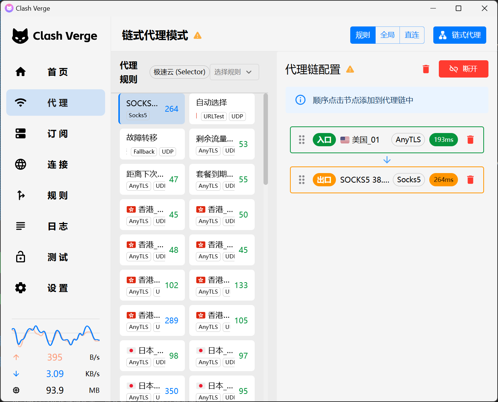
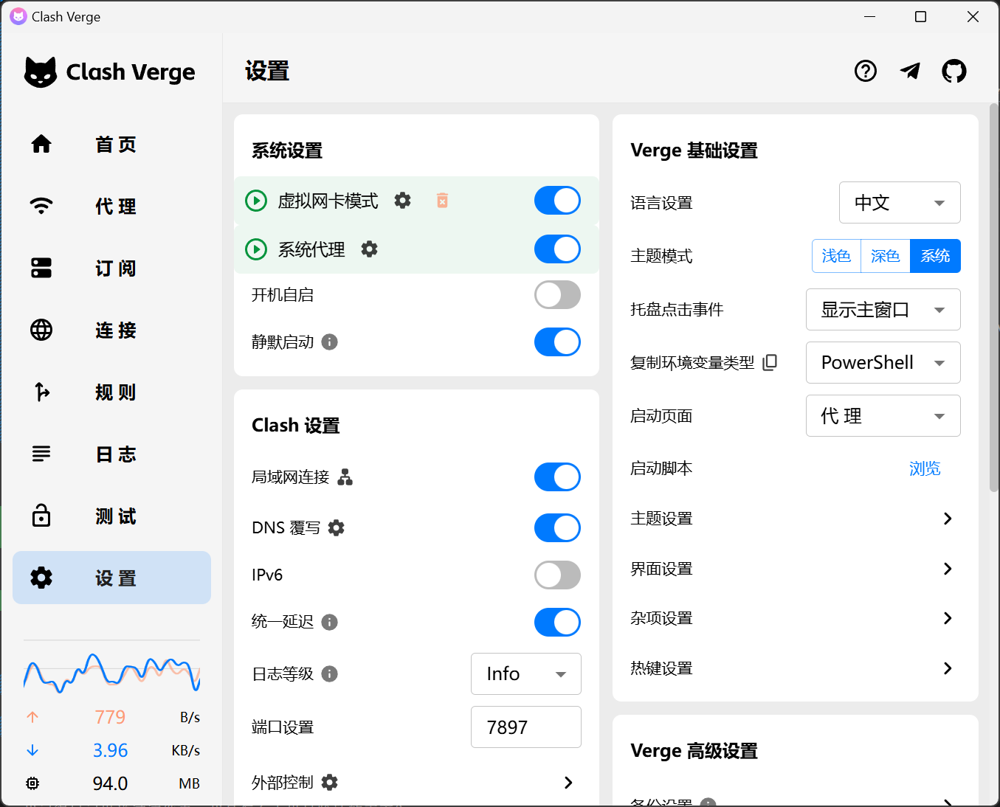
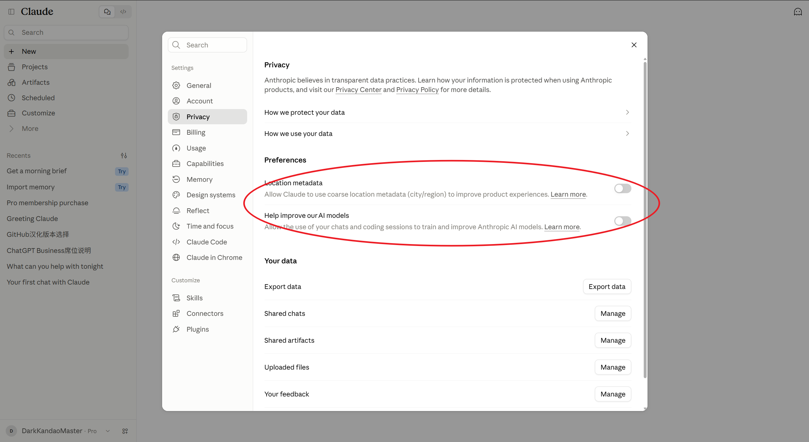
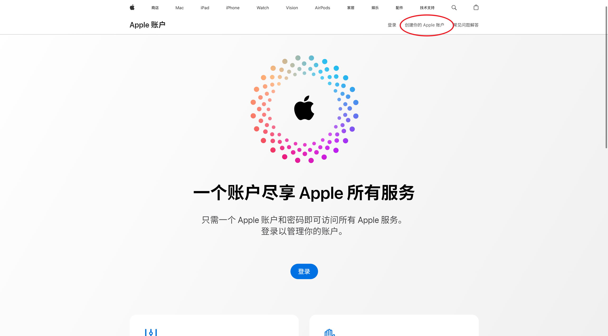

# Claude一直知道我在大陆，但我账号一直没被封。——纯手打的Claude防封指南

首先，我觉得在国内使用 Claude 被封就是时间问题。一个账号能正常用几个月不被封就已经很不错了。对于这个要有心理预期。要有号被封了就新开一个的心理准备。

## 一、注册账号

1. 一个小邮箱。
推荐使用比如 88 邮箱/Inbox 这种邮箱。不要用 Gmail、Outlook 等大邮箱，不然基本都会触发手机号验证。我看这个很多教程都没说到。但这是我和朋友的实际经历。

2. 一个稳定能连上的美国静态 ISP。
我用的是 cliproxy.com 里买的美国纽约长效静态 ISP。试过几家就这家最稳定。
然后自己另外准备一个梯子，链式代理连上 ISP↓

加速器我用的 Clash Verge，设置如下↓

这是我用的 IP 质量查询工具：
https://www.ip2location.com/
https://ippure.com/
https://ipsuper.com/

3. 指纹浏览器。
我用的 Roxy Browser。

行，那我们先来注册一个 Claude 账号。
连上美国静态 ISP，点进指纹浏览器，创建一个窗口，来到 claude.ai，输入邮箱，继续。
这一步如果弹出警告“Unfortunately, Claude is not available to new users right now. We’re working hard to expand our availability soon.”那可能是邮箱的问题，可以换个邮箱试试。参考：https://x.com/KandaoMaster/status/2109618646222033315
然后按我和朋友的实际经历，你应该就能很顺利地直接注册成功了，也不用手机号验证、KYC 什么的。因为目前为止在 Claude 眼里你就是一个美国人。

好了，现在你应该有了一个 Claude 免费账号。注意先把这两个选项关掉：

## 二、购买套餐

需要的材料：

1. 美区虚拟卡。
我用的 wap.roogoo.shop。
你需要下载币安、注册币安、在币安买 USDT、从币安充 USDT 到 Roogoo 平台。
然后在 Roogoo 开卡。一定得是发卡地美国的乐享卡。此时会有一个实名认证，用自己的中国身份证就行了。注意上传的身份证图片一定要裁剪到位，不然实名认证失败三次后就只能等 24 小时后才能再次实名认证了。

2. 美区 Apple/Google 账号。更推荐 Apple，因为 Claude 账号被封可以退款。
来到 account.apple.com，右上角有一个“创建你的 Apple 账户”↓

或者你也可以先注册一个国内 Apple 账号，然后来到上面那个网址，登录，然后切换地区。
然后绑定虚拟卡。
如果注册、绑卡时报错，那估计是 IP 的问题，换成自己另外准备的那个梯子里的节点试试，当然不要频繁变动 IP。Apple 的风控我也搞不懂，非常莫名其妙。

3. 如果你用的是美区 Apple 账号，那还得多一步：
首先看看你能不能用这个 Apple 账号获取免费应用。随便找一个免费应用，点击获取。
然后看看能不能购买付费应用，随便找一个便宜点的付费应用，点击购买。
如果出现以下弹窗（我这两个弹窗都遇到过）：
“无法完成您的购买。请联系 iTunes 支持以完成此交易。” 
“无法完成购买。我们无法验证您的付款方式。”
那去​找苹果人工客服吧，参考：https://help.roogoo.com/zh-CN/articles/13204181-apple-id-%E5%92%8C-app-store-%E8%99%9A%E6%8B%9F%E5%8D%A1%E7%BB%91%E5%AE%9A%E9%97%AE%E9%A2%98

OK，然后苹果手机下载 Claude，登录，走苹果订阅。
如果登录时出现报错“An unknown error has occurred.”那基本可以确定是因为你的 Claude 版本太老了。参考：https://x.com/KandaoMaster/status/2110789725808189882
我的手机型号旧，所以 IOS 更不了，所以 Claude 更不了。对此我的解决方法是借用朋友的苹果手机。

## 三、平时使用

首先得保持 IP 稳定。
可以用我这个项目在任务栏里实时查看自己的 IP：https://github.com/DarkKandaoMaster/IPLocation_for_TrafficMonitor

可以用简体中文和 Claude 对话。
可以用中国时区。
Claude 知道你身在中国也没关系，我的 Claude 天天以我身在中国这个前提为我处理事情。

不要引诱 Claude 暴露思考链，不要让 Claude 做安全方面的活，如果被警告不要反复试。（不过这条我没试过）
我也没有试过多设备登录同一账号。
频繁切换账号我也没试过，不知道影响大不大。

我主用 CC Desktop、CC VS Code 插件，CC CLI 使用较少。
CC Desktop 界面语言、voice 我用的是英文。
我基本每周都把账号的周额度用完。

## 四、补充说明

不要直接在 Claude 网页端用虚拟卡支付！！不然第二天就会被封，我的第一个 Claude 账号就是这么被封的。
不推荐买苹果礼品卡。我有一个美区苹果账号，最近被封了，估计就是这个原因。
不推荐用中国卡（发卡地为中国的卡）购买套餐。我朋友用 Google Play 绑中国卡购买套餐，第二天被封。
也不推荐代充。

如果要手机号验证，这是接码平台：https://hero-sms.com/
如果要 KYC，推荐去微信小程序“移民局12367”预约办个中国护照，这是教程：https://zhuanlan.zhihu.com/p/1937176738871354908
另外这里有一篇关于 KYC 的文章挺有用的：https://github.com/alchaincyf/zhangxuefeng-skill/issues/63
如果 KYC 同时要护照+驾照那就无解。只能找美国朋友，或者tb、海鲜市场了。
这里有一个 KYC 认证后，护照与地区不匹配，号卡死了的案例：https://x.com/KandaoMaster/status/2114147338235290098

如果被封了，填完申诉就准备注册下一个号吧，基本申诉不回来了。

## 五、一些碎碎念

其实之前我就想写一个关于 Claude 防封的文章了，结果因为各种原因一直鸽到了现在。

Claude 我是从去年八月份一直使用到现在，今年五月份被封第一个号，然后就一直和 Anthropic 斗智斗勇到现在。现在我是一个 max 5x 账号，一个 pro 账号，被封三个号。不过三个号都活了好几个月呢。

我的 Claude 天天以我身在中国这个前提为我处理事情，我可能都没有 Claude 了解我自己，公司的项目、自己的项目、论文、比赛，我都在用 Claude。
甚至我的个人网站，就是我把自己的信息全都扔给 Claude，然后让它帮忙设计的。Claude 帮了我很多忙。

其实之前为了 KYC，我申请过一个中国护照，前往地填了美国。结果我就以为这是美国护照...有点尴尬。

另外其实我早就想吐槽苹果了，我一直觉得苹果的东西都挺莫名其妙、遮遮掩掩的，我对苹果一直好感度不高。
